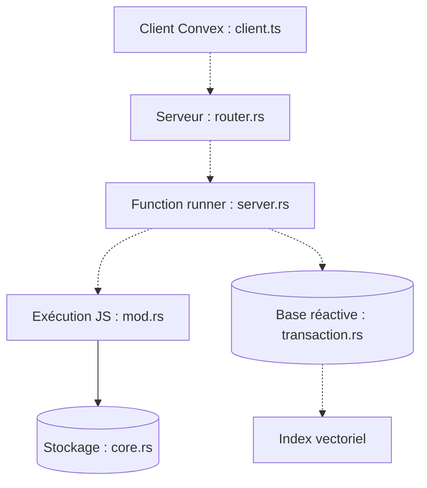

# get-convex/convex-backend

> Base de données réactive open source où l'on écrit la logique serveur en TypeScript, pour développeurs d'applications web.

## Le problème
Garder une interface synchronisée avec des données cohérentes oblige à assembler base, fonctions serveur, cache et temps réel.

## Ce que ça fait vraiment
Le client s'abonne à des requêtes en direct via WebSocket ; le backend Rust exécute des fonctions JavaScript contre une base transactionnelle. S'y ajoutent stockage de fichiers, import/export de snapshots, index texte et vectoriel, connecteur Fivetran. Auto-hébergement par Docker ou binaire précompilé.

## Comment c'est branché


## Essayer
```bash
# Aucune commande documentée dans le README ; voir le guide d'auto-hébergement et BUILD.md.
```

## Coût et pièges
Le cloud a un palier gratuit. En auto-hébergement, changer le secret d'instance et la clé admin par défaut. Une balise anonyme (identifiant, version, uptime) est envoyée, désactivable par `--disable-beacon`.

## Ce que ce n'est pas
Ce n'est pas une base SQL classique. Les tests (dont l'aléatoire) ne sont pas fournis. Moins éprouvé sous Windows.

## Alternatives
Aucune alternative citée dans le README.

## Pour toi
À surveiller : intéressant pour des démos et apps temps réel, mais licence non identifiée et peu de lien avec le travail data.

