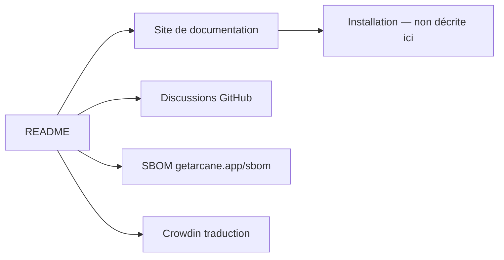

# getarcaneapp/arcane

> Docker management interface; the README describes neither the features nor the installation.

## The problem
Not documented in the README. The name of the Crowdin translation project,
"arcane-docker-management", is the only clue about what the tool is for.

## What it actually does
Minimal entry: the README contains only four pointers — feature requests
moved to Discussions, the official documentation site for installation and
configuration, a software bill of materials (SBOM) published at getarcane.app/sbom, and a call for
translation on Crowdin. No feature description, no screenshot, no architecture.

## How it is wired


## Trying it
```bash
# Aucune commande documentée dans le README : tout renvoie au site de documentation.
```

## Cost and gotchas
Not documented. No license, no prerequisites, no business model in the README. Publishing
an SBOM is a good sign of transparency about dependencies, but does not make up
for the lack of description.

## What it is not
Impossible to say with this README: it does not reveal what the tool does, nor whether it
manages local containers, remote ones, or stacks. It cannot be assessed as it stands.

## Alternatives
No alternative named in the README.

## For you
Nothing to take from it without going to the site: ignore until the README says what it is.
