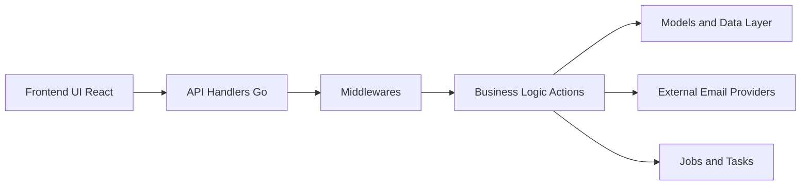

# getfider/fider

> Feedback portal where customers suggest and vote on features.

## The problem
Centralize users' feature requests instead of losing them in emails and chats.

## What it actually does
A Go application with a React frontend: API handlers go through middlewares and business actions, and rely on a SQL database (PostgreSQL according to the migrations) and email (SES, Mailgun, SMTP), billing (Paddle) and storage services. Asynchronous jobs handle notifications and purges.

## How it is wired

## Trying it
No command documented in the README (it points to the documentation for self-hosting).

## Cost and gotchas
Two routes: Fider Cloud, a managed paid service, or free self-hosting at your own expense. A SQL database and an email service are needed.

## What it is not
Not a support or ticketing tool: it is a board of public suggestions.

## Alternatives
No alternative named in the README.

## For you
Ignore: a product/support tool, unrelated to data/AI work.
