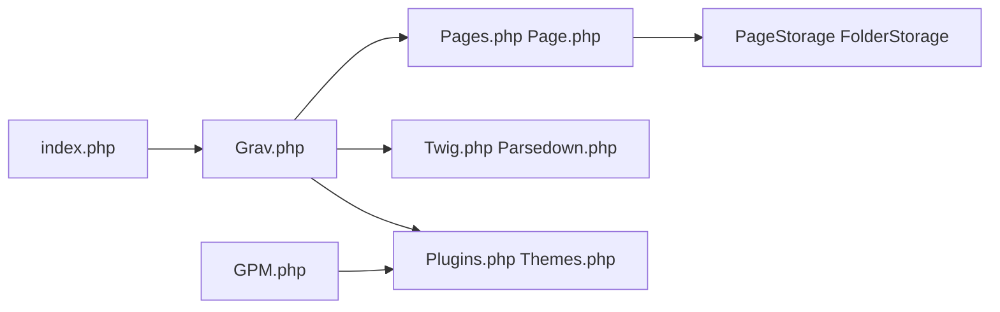

# getgrav/grav

> Flat-file PHP CMS (Markdown, Twig, YAML) with no database, for simple sites.

## The problem
Publishing a site without installing or administering a WordPress-style database.

## What it actually does
The front controller `index.php` loads the `Grav.php` runtime, request processors, pages stored as files (Flex, `PageStorage`), then renders through Twig and Parsedown. Plugins and themes are installed with the GPM manager; a scheduler handles tasks.

## How it is wired


## Trying it
```bash
composer create-project getgrav/grav ~/webroot/grav
bin/gpm index
bin/gpm install <plugin/theme>
bin/gpm selfupgrade
```

## Cost and gotchas
Free. PHP 8.3+ and an Apache/IIS server. Moving from Grav 1.x to 2.0 requires a dedicated migration: `selfupgrade` alone is not enough.

## What it is not
Neither "zero install" in the strict sense (you need PHP and a web server), nor a data tool.

## Alternatives
No alternative named in the README.

## For you
Ignore: a PHP CMS has nothing to do with your data/AI work, except for an occasional need for a static-like site.
