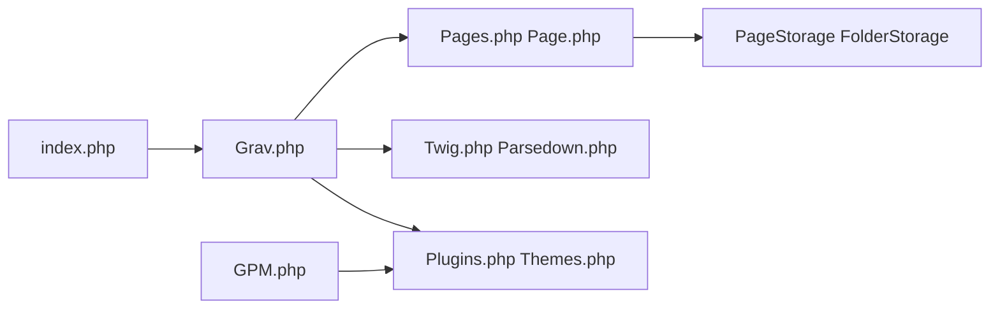

# getgrav/grav

> CMS PHP à fichiers plats (Markdown, Twig, YAML) sans base de données, pour sites simples.

## Le problème
Publier un site sans installer ni administrer une base de données de type WordPress.

## Ce que ça fait vraiment
Le contrôleur frontal `index.php` charge le runtime `Grav.php`, des processeurs de requête, des pages stockées en fichiers (Flex, `PageStorage`), puis rend via Twig et Parsedown. Plugins et thèmes s'installent avec le gestionnaire GPM ; un planificateur gère les tâches.

## Comment c'est branché


## Essayer
```bash
composer create-project getgrav/grav ~/webroot/grav
bin/gpm index
bin/gpm install <plugin/theme>
bin/gpm selfupgrade
```

## Coût et pièges
Gratuit. PHP 8.3+ et serveur Apache/IIS. Le passage de Grav 1.x à 2.0 exige une migration dédiée : `selfupgrade` seul ne suffit pas.

## Ce que ce n'est pas
Ni "zéro installation" au sens strict (il faut PHP et un serveur web), ni un outil de données.

## Alternatives
Aucune alternative nommée dans le README.

## Pour toi
Ignorer : un CMS PHP n'a pas de rapport avec ton métier data/IA, sauf besoin ponctuel d'un site statique-like.

