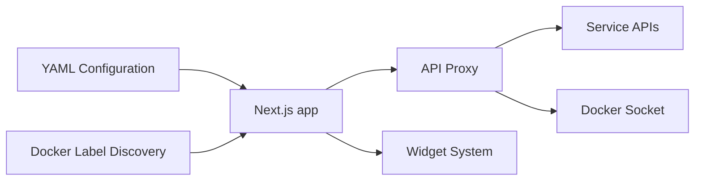

# gethomepage/homepage

> Static dashboard configurable in YAML for self-hosted services.

## The problem
With many self-hosted services, you lose the overview and API keys end up exposed browser-side.

## What it actually does
Statically generated Next.js app; requests to services are proxied server-side to hide the keys.
100+ integrations (*arr, Plex, Jellyfin, qBittorrent…), weather/time/search/glances widgets.
Automatic discovery via Docker labels; YAML configuration; 40+ languages.
Optional OIDC or password login.

## How it is wired
Diagram not provided (no readable component). Based on the described architecture:


## Trying it
```bash
docker run --name homepage \
  -e HOMEPAGE_ALLOWED_HOSTS=gethomepage.dev \
  -p 3000:3000 \
  -v /path/to/config:/app/config \
  ghcr.io/gethomepage/homepage:latest
pnpm install
pnpm dev
```

## Cost and gotchas
Must be behind an authenticated reverse proxy if exposed; mounting the Docker socket grants extended rights.

## What it is not
Not a monitoring or alerting tool. Not relevant to data/AI work.

## Alternatives
No alternative named in the README.

## For you
A dashboard for self-hosted services: handy for your homelab, but with no role in a data or MLOps chain.
