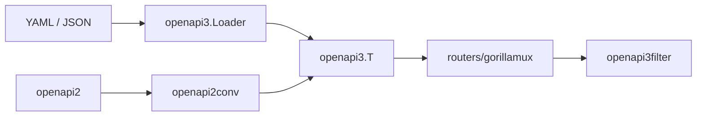

# getkin/kin-openapi

> Go library to load, validate and route OpenAPI 2 and 3 documents.

## The problem
Handling and checking OpenAPI specifications, then validating HTTP requests and responses against them, takes a lot of custom code.

## What it actually does
`openapi3.Loader` loads documents and resolves `$ref`s. The packages `openapi2`, `openapi2conv` (v2 to v3), `openapi3`, `openapi3filter` (HTTP validation), `routers` (gorillamux) and `openapi3gen` (schemas from Go types) cover the rest. Errors have a stable code, and the origin (file, line) can be tracked. Support for 3.2 is partial.

## How it is wired


## Trying it
```bash
go run github.com/getkin/kin-openapi/cmd/validate@latest [--defaults] [--examples] [--ext] [--patterns] -- <local YAML or JSON file>
```

## Cost and gotchas
Free. Breaking changes are frequent: the README changelog lists dozens of versions with API breaks.

## What it is not
Not a server generator. No full support for OpenAPI 3.2.

## Alternatives
- libopenapi: complete parser and toolkit for OpenAPI 3.1, 3.0 and Swagger.

## For you
Worth watching if you validate API contracts in Go: solid, but plan for maintenance at each version upgrade.
