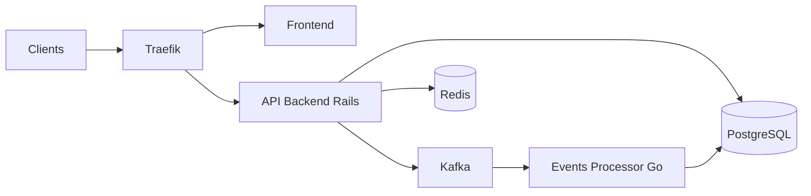

# getlago/lago

> Open-source usage-based billing platform (metering, pricing, invoices), geared towards AI products.

## The problem
Billing tokens, GPU compute or API calls requires reliable metering, changing price grids and invoices, without rewriting billing for every offer.

## What it actually does
Ingests idempotent usage events (`transaction_id`) and aggregates them into billable metrics.
Usage-based pricing, tiers, prepaid credits, subscriptions, entitlements; invoices, taxes, dunning.
REST/OpenAPI API, SDKs (Node, Python, Ruby, Go), CLI, MCP server, agent SDK to instrument LLM calls.
Rails backend + Go event processor, PostgreSQL, Redis; payments via Stripe, Adyen, GoCardless.

## How it is wired


## Trying it
```bash
./examples/agentic-ai-demo/run.sh
./examples/agentic-ai-demo/run.sh --cleanup
git clone --depth 1 https://github.com/getlago/lago.git
cd lago
echo "LAGO_RSA_PRIVATE_KEY=\"$(openssl genrsa 2048 | openssl base64 -A)\"" >> .env
docker compose up -d
```

## Cost and gotchas
Open source AGPLv3; Lago Cloud and Premium features are paid. Product analytics enabled by default when self-hosted (opt-out possible).

## What it is not
Not a payment processor: it orchestrates Stripe/Adyen. Some assistants (Billing Assistant) are Premium or in beta.

## Alternatives
None named in the README.

## For you
Watch: relevant if you need to monetise a model API per token, with a local demo that shows the calculation; otherwise out of scope.
