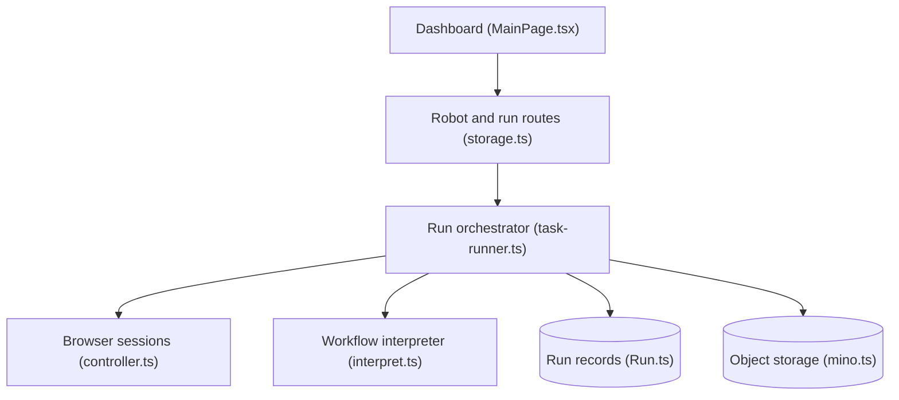

# getmaxun/maxun

> Open source platform for scraping, crawling and extracting web data with recorded or AI-driven robots.

## The problem
Extracting structured data from a site without an API forces you to write and maintain fragile scrapers.

## What it actually does
A dashboard lets you record browser actions as reusable robots, or describe in natural language what you want to extract. The server launches runs, drives the browser, interprets the workflow and stores the results. It also offers Markdown scrape, crawl, search, change tracking, document extraction, export to Google Sheets and Airtable, API, SDK, CLI and MCP.

## How it is wired

## Trying it
No command in the README: installation is deferred to external pages (Docker Compose, non-Docker, environment variables). A hosted version exists at https://app.maxun.dev.

## Cost and gotchas
The hosted version is probably paid beyond a threshold, which is not specified. Locally, you need Docker or a manual installation, and probably keys for the AI mode. Respect the terms of the scraped sites.

## What it is not
Not a maintenance-free tool: robots can break when a site changes. AGPL-3.0 license: sharing obligations if you offer the service over a network.

## Alternatives
No alternative named in the README.

## For you
Worth watching: useful to feed a data pipeline from the web, but the AGPL and the absence of an installation procedure in the README call for a check before adoption.
