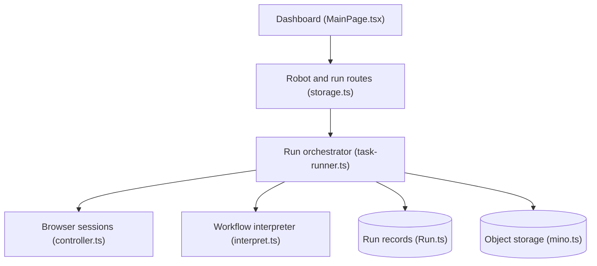

# getmaxun/maxun

> Plateforme open source de scraping, crawl et extraction de données web par robots enregistrés ou pilotés par IA.

## Le problème
Extraire des données structurées d'un site sans API oblige à écrire et maintenir des scrapers fragiles.

## Ce que ça fait vraiment
Un tableau de bord permet d'enregistrer des actions de navigateur comme des robots réutilisables, ou de décrire en langage naturel ce qu'on veut extraire. Le serveur lance les exécutions, pilote le navigateur, interprète le workflow et stocke les résultats. Il propose aussi scrape en Markdown, crawl, recherche, suivi des changements, extraction de documents, export vers Google Sheets et Airtable, API, SDK, CLI et MCP.

## Comment c'est branché

## Essayer
Aucune commande dans le README : l'installation est renvoyée à des pages externes (Docker Compose, hors Docker, variables d'environnement). Une version hébergée existe à https://app.maxun.dev.

## Coût et pièges
La version hébergée est probablement payante au-delà d'un seuil, non précisé. En local, il faut Docker ou une installation manuelle, et probablement des clés pour le mode IA. Respecter les conditions des sites scrapés.

## Ce que ce n'est pas
Pas un outil sans maintenance : les robots peuvent casser quand un site change. Licence AGPL-3.0 : obligations de partage si tu proposes le service en réseau.

## Alternatives
Aucune alternative nommée dans le README.

## Pour toi
À surveiller : utile pour alimenter un pipeline de données depuis le web, mais l'AGPL et l'absence de procédure d'installation dans le README demandent une vérification avant adoption.

