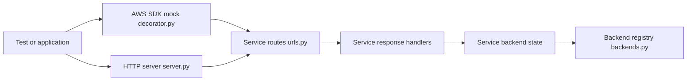

# getmoto/moto

> Python library that simulates AWS services in memory to test boto3 code.

## The problem
Testing code that calls S3, DynamoDB or another AWS service forces you either to hit a real account (slow, costly) or to write brittle mocks.

## What it actually does
The `@mock_aws` decorator intercepts boto3 calls and serves them from a virtual AWS account that keeps state (buckets, keys…). An HTTP server mode also accepts requests in AWS format. Wide service coverage, detailed in the coverage page; Step Functions even have a workflow evaluator and an event history.

## How it is wired


## Trying it
```bash
pip install 'moto[ec2,s3,all]'
```

## Cost and gotchas
Free, funded through OpenCollective. The extras (`[s3]`, `[all]`) determine which services are available.

## What it is not
Not a full AWS emulator: coverage varies by service and feature. Does not replace an integration test against the real cloud.

## Alternatives
No alternative named in the README.

## For you
Adopt it to test pipelines that read or write on S3/DynamoDB: a single decorator is enough, tests become fast and free, and the project has been maintained since 2013.
