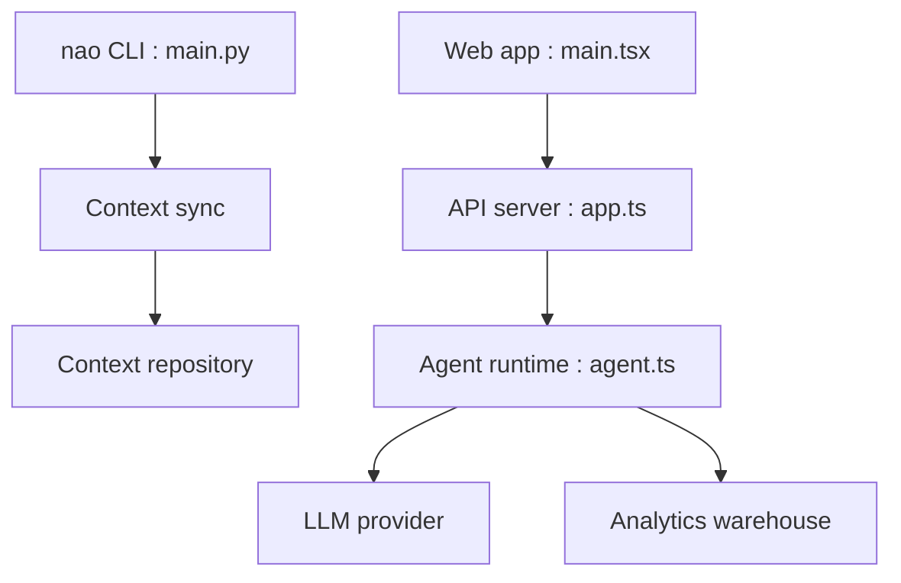

# getnao/nao

> Open source builder for a BI analytics agent: a context layer tested by the data team, used by everyone.

## The problem
"Chat with your data" agents answer wrongly without controlled context, and nothing lets you test their changes before going live.

## What it actually does
The `nao-core` CLI syncs warehouse, dbt and docs into files the agent reads, with a `RULES.md`. Questions go through the web app, Slack, Teams or an MCP client; results become "stories". `nao test` replays questions against the expected SQL. An Enterprise edition adds SSO, row-level security and LLM budgets.

## How it is wired


## Trying it
```bash
pip install nao-core
nao skills add getnao/nao
nao init
nao debug
nao sync
nao chat
nao test
```

## Cost and gotchas
LLM key at your expense; Enterprise version under annual license, with a heartbeat to licenses.getnao.io for online licenses. nao Cloud offering in parallel. 347 open issues.

## What it is not
Not a simple dashboard tool: the value lies in the context effort you must provide. The license is presented as Apache 2.0 but is not identified by GitHub.

## Alternatives
No alternative named in the README, except migration from Metabase and Tableau.

## For you
Worth watching: offline evaluation of context changes speaks to a data profile; check the license and the Enterprise share first.
