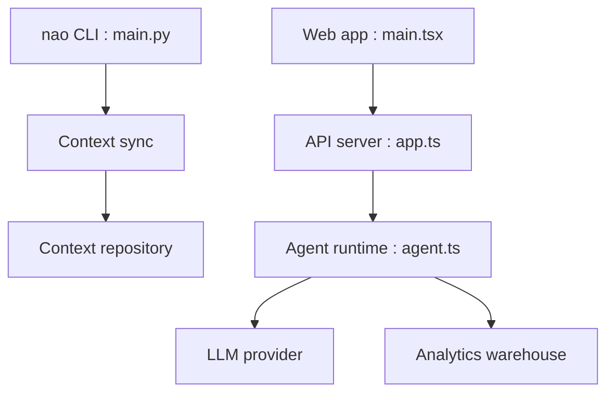

# getnao/nao

> Constructeur open source d'agent analytique BI : une couche de contexte testée par l'équipe data, utilisée par tous.

## Le problème
Les agents « chat avec tes données » répondent faux sans contexte maîtrisé, et rien ne permet de tester leurs changements avant mise en ligne.

## Ce que ça fait vraiment
La CLI `nao-core` synchronise entrepôt, dbt et docs en fichiers que l'agent lit, avec un `RULES.md`. Les questions passent par l'appli web, Slack, Teams ou un client MCP ; les résultats deviennent des « stories ». `nao test` rejoue des questions contre le SQL attendu. Une édition Enterprise ajoute SSO, sécurité par ligne et budgets LLM.

## Comment c'est branché


## Essayer
```bash
pip install nao-core
nao skills add getnao/nao
nao init
nao debug
nao sync
nao chat
nao test
```

## Coût et pièges
Clé LLM à ta charge ; version Enterprise sous licence annuelle, avec un battement de coeur vers licenses.getnao.io pour les licences en ligne. Offre nao Cloud en parallèle. 347 issues ouvertes.

## Ce que ce n'est pas
Pas un simple outil de dashboards : la valeur est dans l'effort de contexte à fournir. La licence est présentée comme Apache 2.0 mais n'est pas identifiée par GitHub.

## Alternatives
Aucune alternative nommée dans le README, sauf la migration depuis Metabase et Tableau.

## Pour toi
À surveiller : l'évaluation hors ligne des changements de contexte parle à un profil data ; vérifie d'abord la licence et la part Enterprise.

