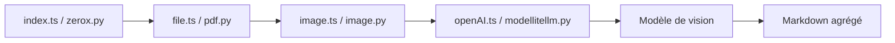

# getomni-ai/zerox

> Node and Python SDK that converts documents to Markdown by having a vision model read them page by page.

## The problem
PDFs with tables, charts and complex layouts go poorly through a classic OCR before ingestion by an LLM.

## What it actually does
Converts the file to images, sends each page to a vision model, aggregates the Markdown. `maintainFormat` option: the previous page serves as context (slower). The Node SDK adds schema-based structured extraction, orientation correction and cropping; the Python SDK goes through LiteLLM.

## How it is wired


## Trying it
```bash
npm install zerox
pip install py-zerox
```
```ts
const result = await zerox({ filePath: "path/to/file", credentials: { apiKey: process.env.OPENAI_API_KEY } });
```

## Cost and gotchas
One vision request per page: the bill is yours. System dependencies: graphicsmagick (Node), poppler (Python). Last push May 2025.

## What it is not
The two SDKs do not have the same features (data extraction and tunable errors on the Node side only). Quality is not measured in the README.

## Alternatives
No alternative named in the README.

## For you
Worth watching: a simple approach for complex documents, but cost grows linearly per page and activity has been declining since May 2025; estimate the cost on one document before any batch.
