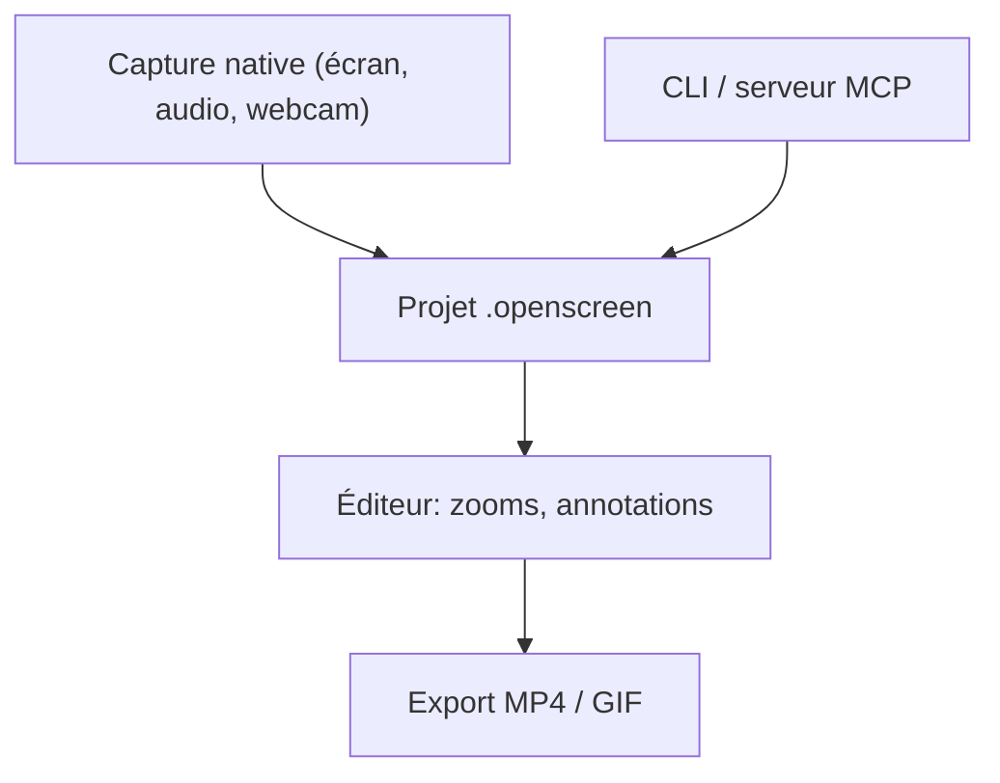

# getopenscreen/openscreen

> Open source screen-recording editor that produces ready-to-publish demos, with a CLI for agents.

## The problem
A raw screen recording needs a lot of editing to become a presentable demo.

## What it actually does
Records a window or screen, microphone, system audio and webcam. Adds automatic zooms, a custom cursor, locally transcribed subtitles, annotations, backgrounds and MP4 or GIF export with GPU encoding. A windowless CLI lets an agent record, edit the `.openscreen` file and export. An editing assistant uses your own API key and is disabled by default.

## How it is wired
Simplified diagram based on the sheet, no diagram provided.



## Trying it
```bash
openscreen record --duration 20 --project demo.openscreen --json
openscreen export demo.openscreen -o demo.mp4 --json
npx skills add getopenscreen/openscreen --skill openscreen-demo -y
```

## Cost and gotchas
Free. 8 GB of RAM minimum. The README warns of breaking changes to the project format and the CLI. The Windows `.exe` installer is unsigned. Linux requires PipeWire for system audio.

## What it is not
Not the original project: it is the community continuation of an archived repo. Not a cloud service.

## Alternatives
- Screen Studio: the category reference cited in the README.

## For you
Worth watching: handy for filming project or PR demos, but the project is young and its format unstable.
