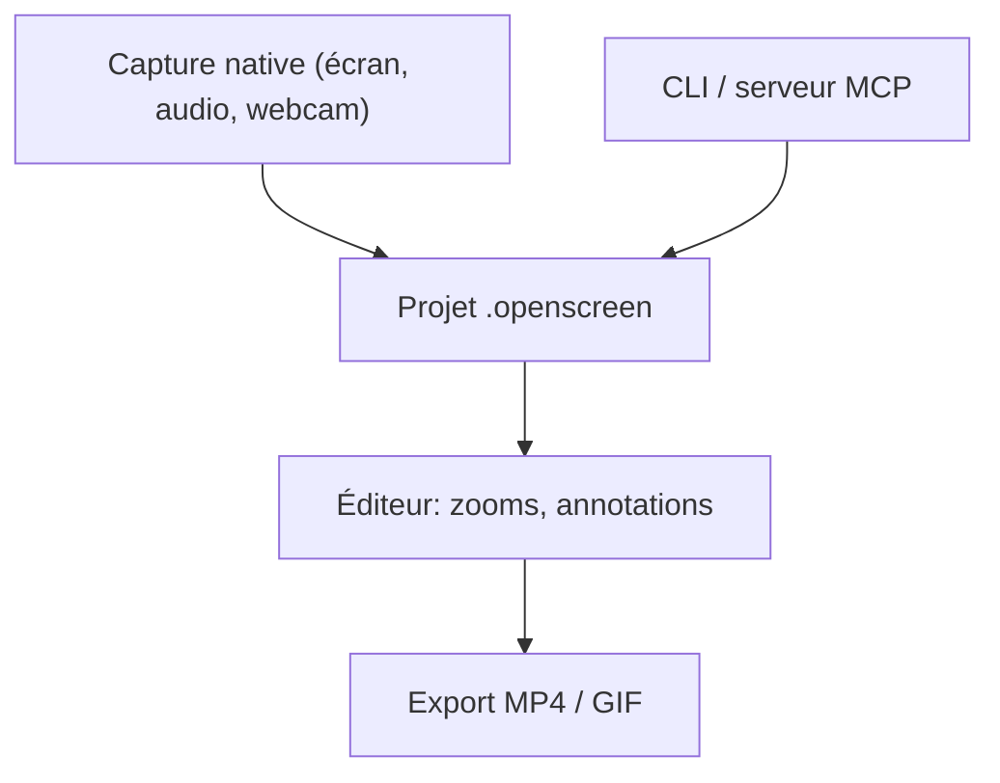

# getopenscreen/openscreen

> Éditeur d'enregistrement d'écran open source qui produit des démos prêtes à publier, avec CLI pour agents.

## Le problème
Un enregistrement brut d'écran demande beaucoup de montage pour devenir une démo présentable.

## Ce que ça fait vraiment
Enregistre fenêtre ou écran, micro, audio système et webcam. Ajoute zooms automatiques, curseur personnalisé, sous-titres transcrits localement, annotations, fonds et export MP4 ou GIF avec encodage GPU. Une CLI sans fenêtre permet à un agent d'enregistrer, éditer le fichier `.openscreen` et exporter. Un assistant d'édition utilise ta propre clé d'API et reste désactivé par défaut.

## Comment c'est branché
Schéma simplifié d'après la fiche, sans diagramme fourni.



## Essayer
```bash
openscreen record --duration 20 --project demo.openscreen --json
openscreen export demo.openscreen -o demo.mp4 --json
npx skills add getopenscreen/openscreen --skill openscreen-demo -y
```

## Coût et pièges
Gratuit. 8 Go de RAM minimum. Le README prévient de changements incompatibles du format de projet et de la CLI. L'installeur Windows `.exe` n'est pas signé. Linux demande PipeWire pour l'audio système.

## Ce que ce n'est pas
Pas le projet d'origine : c'est la suite communautaire d'un dépôt archivé. Pas un service cloud.

## Alternatives
- Screen Studio : la référence de la catégorie citée dans le README.

## Pour toi
À surveiller : pratique pour filmer des démos de projets ou de PR, mais le projet est jeune et son format instable.

