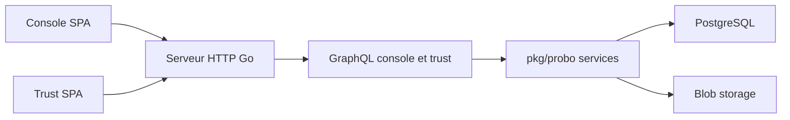

# getprobo/probo

> Self-hostable GRC platform for technical teams, drivable through web, CLI, GraphQL and MCP agents.

## The problem
Tracking risks, controls, vendors and audits in spreadsheets cannot be automated and leaves no usable trail.

## What it actually does
A web console, a `prb` CLI, a GraphQL API and more than 270 MCP tools covering: risk register, controls and frameworks, vendor risk, privacy (DPIA), access reviews, audits, evidence, signed documents, public compliance page. From the code: a Go binary `probod`, two React SPAs (console and trust), PostgreSQL, S3 or local storage.

## How it is wired


## Trying it
```bash
git clone --recurse-submodules https://github.com/getprobo/probo.git
cd probo
go mod download
npm ci
make stack-up
make build
make dev-config
bin/probod -cfg-file cfg/dev.yaml
```

## Cost and gotchas
Go 1.27+, Node 24.15+, npm 12.0.2+, Docker and mkcert. Development version: going to production is covered in CONTRIBUTING.md. The MCP tools give an LLM agent write access to compliance data.

## What it is not
Not a security tool or a scanner: it organizes compliance tracking. It does not replace an auditor.

## Alternatives
No alternative named in the README.

## For you
Keep an eye on it: interesting if you must document the compliance of AI platforms (DPIA, vendors) and automate it through MCP, but the GRC scope is outside your data core.
