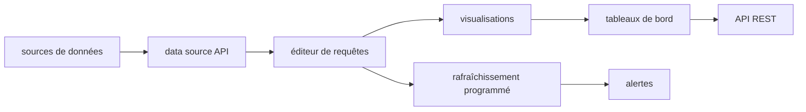

# getredash/redash

> Web interface for writing queries, visualizing them and sharing dashboards.

## The problem
Useful SQL queries sit dormant in everyone's local files, with no review or sharing.
Non-technical people depend on an analyst for every figure that needs refreshing.

## What it actually does
SQL and NoSQL query editor with schema browser and autocompletion, all in the browser.
Visualizations built by drag and drop, assembled into dashboards shareable by URL.
Scheduled refresh at a chosen interval; alerts triggered on a condition when the data changes.
REST API covering everything the interface does; extensible data source API with native support for a long list of databases.

## How it is wired

## Trying it
No install command is written in the README: it points to the "Setting up a Redash instance" page, which includes ready-to-use AWS/GCE images.

## Cost and gotchas
Nothing to pay for the software, but it is an instance you must host, back up and update.
Scheduled refreshes really query your databases: the cost shifts to the data warehouse side.

## What it is not
It is not a modeling or transformation tool: it reads, it does not build the tables.
It is not a full BI tool: no semantic layer or shared metrics described here.
The README mentions no license, no system requirements, and no managed offering.

## Alternatives
No alternative named in the README.

## For you
Useful as a shared SQL front desk for a non-technical team; dispensable if everyone lives in notebooks.
