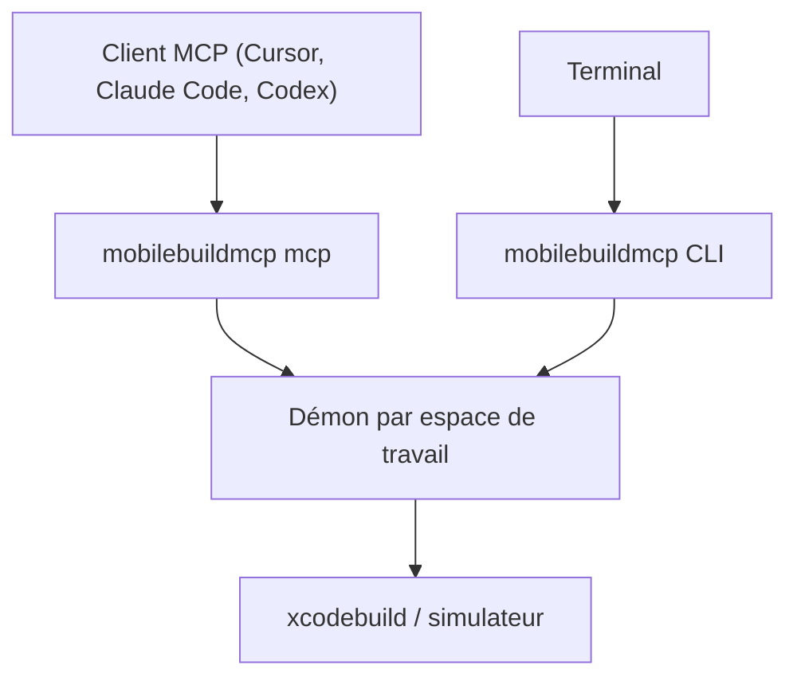

# getsentry/XcodeBuildMCP

> MCP server and CLI that give an agent tools to build iOS and macOS projects.

## The problem
A coding agent cannot properly drive Xcode: building, testing on a simulator, debugging.

## What it actually does
A single package, two modes: a CLI for the terminal and an MCP server for agents. Builds for the simulator, prepares and runs test products, and manages devices (signing required). One daemon per workspace keeps state (logs, debugging). Two optional skills prepare the agent. An `upgrade` command updates in place.

## How it is wired
Simplified diagram based on the sheet, no diagram provided.



## Trying it
```bash
npm install -g mobilebuildmcp@latest
mobilebuildmcp --help
mobilebuildmcp tools
mobilebuildmcp simulator build --scheme MyApp --project-path ./MyApp.xcodeproj
```

## Cost and gotchas
Free. Requires macOS 14.5+ and Xcode 16+. Sentry collects runtime error telemetry (can be disabled). Device tools require code signing configured in Xcode.

## What it is not
Not cross-platform: unusable outside macOS. The README says "MobileBuildMCP" while the repository is named XcodeBuildMCP.

## Alternatives
No alternative named in the README.

## For you
Ignore: useful only for iOS/macOS development, unrelated to a data / AI / MLOps profile on Linux.
