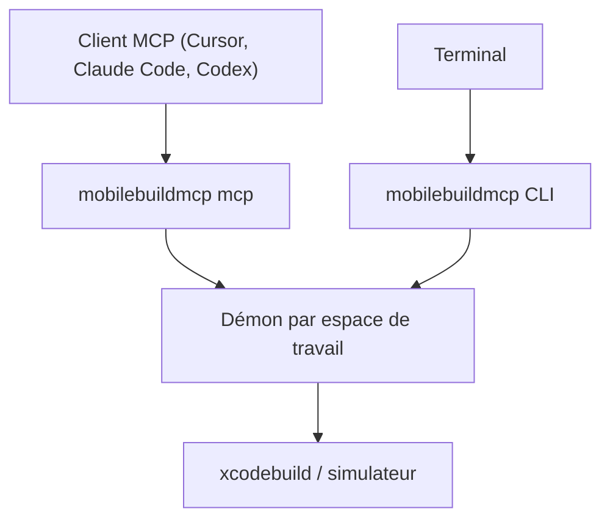

# getsentry/XcodeBuildMCP

> Serveur MCP et CLI qui donnent à un agent des outils pour construire des projets iOS et macOS.

## Le problème
Un agent de code ne sait pas piloter proprement Xcode : construire, tester sur simulateur, déboguer.

## Ce que ça fait vraiment
Un seul paquet, deux modes : CLI pour le terminal et serveur MCP pour agents. Construit pour simulateur, prépare et exécute des produits de test, et gère les appareils (signature requise). Un démon par espace de travail garde l'état (journaux, débogage). Deux skills optionnels préparent l'agent. Un `upgrade` met à jour sur place.

## Comment c'est branché
Schéma simplifié d'après la fiche, sans diagramme fourni.



## Essayer
```bash
npm install -g mobilebuildmcp@latest
mobilebuildmcp --help
mobilebuildmcp tools
mobilebuildmcp simulator build --scheme MyApp --project-path ./MyApp.xcodeproj
```

## Coût et pièges
Gratuit. Exige macOS 14.5+ et Xcode 16+. Sentry collecte de la télémétrie d'erreurs d'exécution (désactivable). Les outils d'appareil demandent la signature de code configurée dans Xcode.

## Ce que ce n'est pas
Pas multiplateforme : inutilisable hors macOS. Le README parle de « MobileBuildMCP » alors que le dépôt s'appelle XcodeBuildMCP.

## Alternatives
Aucune alternative nommée dans le README.

## Pour toi
À ignorer : utile seulement pour du développement iOS/macOS, sans rapport avec un profil data / IA / MLOps sous Linux.

