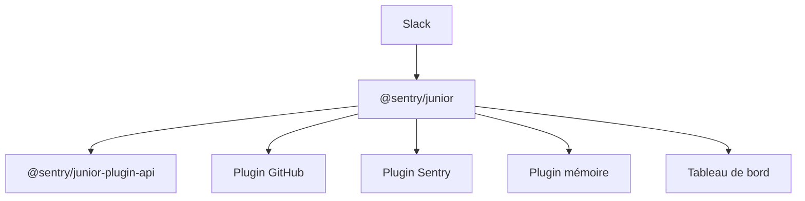

# getsentry/junior

> Runtime for a Slack bot, built on Hono, to investigate and act from Slack with connected tools.

## The problem
Investigating an incident forces you to jump from one tool to another (Sentry, GitHub, Datadog, PagerDuty) outside Slack.

## What it actually does
Junior is an agent plugged into Slack, which summarizes context and acts through plugins: GitHub, Linear, Notion, Sentry, Datadog, PagerDuty, Vercel, Google Workspace, Amplitude, long-term memory. Each plugin is an `@sentry/junior-*` package. A dashboard and a plugin API exist. The README says the project is evolving fast.

## How it is wired
Simplified diagram based on the sheet, no diagram provided.

## Trying it
No command documented in the README: the documentation is at https://junior.sentry.dev/ (quick start, Slack configuration, deployment on Vercel).

## Cost and gotchas
You need a Slack app, a deployment (Vercel is mentioned) and accounts for the connected services. The bill for models and APIs is on you; the README does not detail the model provider.

## What it is not
It is not a turnkey autonomous assistant: each plugin requires its own configuration. It is not stable, according to the README.

## Alternatives
No alternative named in the README.

## For you
Worth watching if your team lives in Slack and Sentry and wants an investigation agent; too young and dependent on third-party services to adopt it yet.
