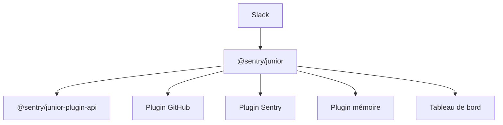

# getsentry/junior

> Environnement d'exécution d'un robot Slack, bâti sur Hono, pour enquêter et agir depuis Slack avec des outils connectés.

## Le problème
Enquêter sur un incident oblige à passer d'un outil à l'autre (Sentry, GitHub, Datadog, PagerDuty) hors de Slack.

## Ce que ça fait vraiment
Junior est un agent branché sur Slack, qui résume du contexte et agit via des plugins : GitHub, Linear, Notion, Sentry, Datadog, PagerDuty, Vercel, Google Workspace, Amplitude, mémoire à long terme. Chaque plugin est un paquet `@sentry/junior-*`. Un tableau de bord et une API de plugin existent. Le README dit que le projet évolue vite.

## Comment c'est branché
Schéma simplifié d'après la fiche, sans diagramme fourni.

## Essayer
Aucune commande documentée dans le README : la documentation est sur https://junior.sentry.dev/ (démarrage rapide, configuration Slack, déploiement sur Vercel).

## Coût et pièges
Il faut une application Slack, un déploiement (Vercel cité) et les comptes des services branchés. La facture des modèles et des API reste à ta charge ; le README ne détaille pas le fournisseur du modèle.

## Ce que ce n'est pas
Ce n'est pas un assistant autonome clé en main : chaque plugin demande sa propre configuration. Ce n'est pas stable, selon le README.

## Alternatives
Aucune alternative nommée dans le README.

## Pour toi
À surveiller si ton équipe vit dans Slack et Sentry et veut un agent d'enquête ; trop jeune et dépendant de services tiers pour l'adopter déjà.

