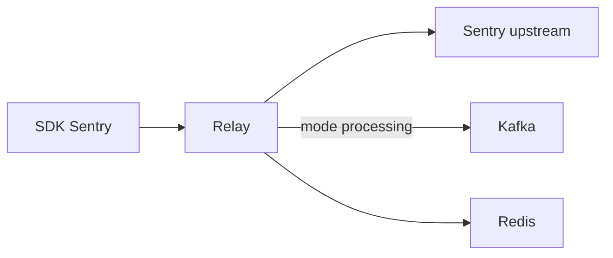

# getsentry/relay

> Official Sentry proxy that moves part of the SDK and server processing to a dedicated process.

## The problem
The Sentry server and SDKs carry event filtering and normalization tasks that are better handled closer to the source.

## What it actually does
Rust service that acts as a proxy to Sentry. With the `processing` feature, it normalizes, filters and rate-limits events, then writes them to a Kafka topic. The `crash-handler` feature reports crashes. The repository also contains a Python package tied to a C ABI.

## How it is wired
Simplified diagram based on the sheet, no diagram provided.



## Trying it
```bash
rustup update
cargo run --all-features -- config init
cargo run --all-features -- run
```

## Cost and gotchas
Recent stable Rust, CMake and a C compiler for `processing`. Integration tests require Redis and Kafka. The repository has strict rules on AI use (HOWTOAI.md file). License present but not identified.

## What it is not
The README is a development guide, not an installation guide. Not a standalone tool: it assumes an upstream Sentry.

## Alternatives
No alternative named in the README.

## For you
Ignore: infrastructure component internal to Sentry, only useful if you operate your own Sentry instance.
