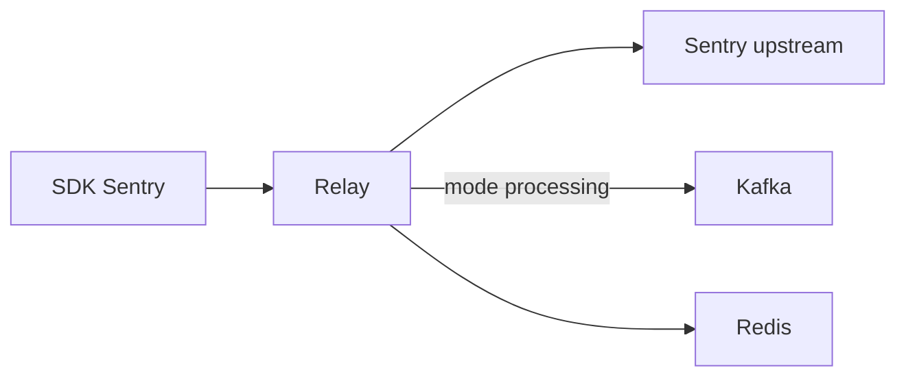

# getsentry/relay

> Proxy officiel de Sentry qui déplace une partie du traitement des SDK et du serveur vers un processus dédié.

## Le problème
Le serveur Sentry et les SDK portent des tâches de filtrage et de normalisation d'événements qui gagnent à être traitées plus près de la source.

## Ce que ça fait vraiment
Service en Rust qui sert de proxy vers Sentry. Avec la fonctionnalité `processing`, il normalise, filtre et limite les événements, puis les écrit dans un topic Kafka. La fonctionnalité `crash-handler` signale les plantages. Le dépôt contient aussi un paquet Python lié à une ABI C.

## Comment c'est branché
Schéma simplifié d'après la fiche, sans diagramme fourni.



## Essayer
```bash
rustup update
cargo run --all-features -- config init
cargo run --all-features -- run
```

## Coût et pièges
Rust stable récent, CMake et un compilateur C pour `processing`. Les tests d'intégration exigent Redis et Kafka. Le dépôt a des règles strictes sur l'usage de l'IA (fichier HOWTOAI.md). Licence présente mais non identifiée.

## Ce que ce n'est pas
Le README est un guide de développement, pas un guide d'installation. Ce n'est pas un outil autonome : il suppose un Sentry en amont.

## Alternatives
Aucune alternative nommée dans le README.

## Pour toi
Ignorer : composant d'infrastructure interne à Sentry, utile seulement si tu opères ta propre instance Sentry.

