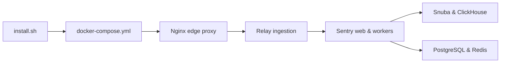

# getsentry/self-hosted

> Docker Compose deployment of Sentry for low-volume self-hosted use or proof of concept.

## The problem
Track application errors and crashes without sending the data to a SaaS.

## What it actually does
The README is three lines long (insufficient material). From the code: install and update scripts, `docker-compose.yml`, Nginx, Relay, Symbolicator, Snuba, ClickHouse, PostgreSQL, Redis, Kafka streams, S3 storage, backup and restore scripts.

## How it is wired


## Trying it
```bash
# Aucune commande dans le README ; le dépôt fournit install.sh, sentry-admin.sh et scripts/backup.sh.
```

## Cost and gotchas
Heavy stack (Kafka, ClickHouse, Postgres, Redis): plan for a lot of RAM. Low volume only, according to the README. License "not identified" in the catalog.

## What it is not
Not the Sentry code: a packaging. Not designed for large volumes.

## Alternatives
No alternative named in the README.

## For you
Keep an eye on it: useful for monitoring inference services in-house, provided you accept a heavy stack and check the license.
