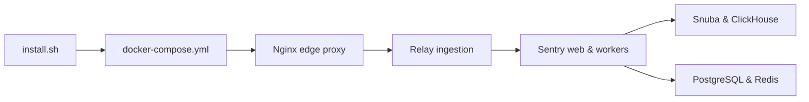

# getsentry/self-hosted

> Déploiement Docker Compose de Sentry pour usage auto-hébergé à faible volume ou preuve de concept.

## Le problème
Suivre erreurs et plantages d'applications sans envoyer les données à un SaaS.

## Ce que ça fait vraiment
Le README tient en trois lignes (matière insuffisante). D'après le code : scripts d'installation et de mise à jour, `docker-compose.yml`, Nginx, Relay, Symbolicator, Snuba, ClickHouse, PostgreSQL, Redis, flux Kafka, stockage S3, scripts de sauvegarde et de restauration.

## Comment c'est branché


## Essayer
```bash
# Aucune commande dans le README ; le dépôt fournit install.sh, sentry-admin.sh et scripts/backup.sh.
```

## Coût et pièges
Pile lourde (Kafka, ClickHouse, Postgres, Redis) : prévoir beaucoup de RAM. Faible volume seulement, selon le README. Licence « non identifiée » au catalogue.

## Ce que ce n'est pas
Pas le code de Sentry : un empaquetage. Pas prévu pour de gros volumes.

## Alternatives
Aucune alternative nommée dans le README.

## Pour toi
À surveiller : utile pour superviser des services d'inférence en interne, à condition d'accepter une pile lourde et de vérifier la licence.

