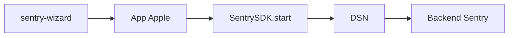

# getsentry/sentry-cocoa

> Official Sentry SDK for iOS, iPadOS, tvOS, macOS, watchOS and visionOS apps.

## The problem
Crashes and errors in Apple apps are hard to see in production without centralized reporting and symbolication.

## What it actually does
Initializes at launch with a DSN (`SentrySDK.start`) and sends crashes and errors to Sentry. Installation via Swift Package Manager (compiled) or prebuilt XCFrameworks; CocoaPods is no longer supported (last version 9.19.1). The README states that `main` carries v9 in development. watchOS: limited symbolication, no crash handling.

## How it is wired


## Trying it
```bash
brew install getsentry/tools/sentry-wizard && sentry-wizard -i ios
```

## Cost and gotchas
Requires a Sentry project (account, DSN). The DSN is that of your project. Plans and quotas are on the Sentry side, not specified here.

## What it is not
Not an ML model monitoring tool: it monitors Apple apps.

## Alternatives
- sentry-apple-binaries: prebuilt static binaries via SPM (cited).

## For you
Ignore: unless you ship an iOS app with Sentry, it brings nothing to a data/AI/MLOps profile.
