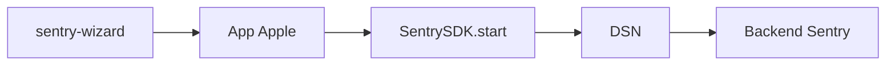

# getsentry/sentry-cocoa

> SDK officiel Sentry pour apps iOS, iPadOS, tvOS, macOS, watchOS et visionOS.

## Le problème
Les crashs et erreurs d'apps Apple sont difficiles à voir en production sans remontée centralisée et symbolication.

## Ce que ça fait vraiment
S'initialise au lancement avec un DSN (`SentrySDK.start`) et envoie crashs et erreurs vers Sentry. Installation par Swift Package Manager (compilation) ou XCFrameworks préconstruits ; CocoaPods n'est plus supporté (dernière version 9.19.1). Le README indique que `main` porte la v9 en développement. watchOS : symbolication limitée, pas de crash handling.

## Comment c'est branché


## Essayer
```bash
brew install getsentry/tools/sentry-wizard && sentry-wizard -i ios
```

## Coût et pièges
Nécessite un projet Sentry (compte, DSN). Le DSN est celui de ton projet. Plans et quotas côté Sentry, non précisés ici.

## Ce que ce n'est pas
Pas un outil de monitoring de modèles ML : il surveille des apps Apple.

## Alternatives
- sentry-apple-binaries : binaires statiques préconstruits via SPM (cité).

## Pour toi
À ignorer : sauf si tu livres une app iOS avec Sentry, il n'apporte rien à un profil data/IA/MLOps.

