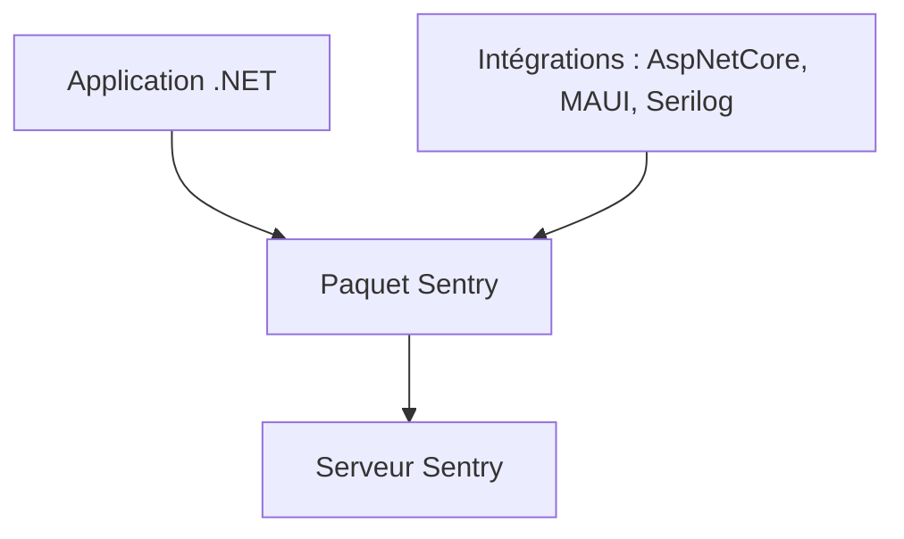

# getsentry/sentry-dotnet

> Sentry software development kit for .NET applications, with ASP.NET, MAUI, Serilog and other integrations.

## The problem
Errors in a production .NET application stay invisible without centralized reporting.

## What it actually does
The repository publishes a suite of NuGet packages: the `Sentry` core and integrations (ASP.NET Core, Blazor, MAUI, Entity Framework, Hangfire, Quartz, logging, OpenTelemetry, profiling). A `Sentry.Extensions.AI` package exists for tracking AI agent modules. Details are in the official documentation.

## How it is wired
Simplified diagram based on the sheet, no diagram provided.

## Trying it
No command documented in the README: installation goes through the NuGet packages listed in the table.

## Cost and gotchas
A Sentry server is needed to receive events; its pricing is not described in the README. Choose between Quartz3 (Quartz.NET 3.6+) and Quartz (4.x).

## What it is not
It is not the monitoring tool itself, only the .NET client. Unity and PowerShell have separate repositories.

## Alternatives
No alternative cited in the README.

## For you
Ignore for a data / AI / MLOps profile unless you write .NET: it is a mature SDK but unrelated to Python or data pipelines.
