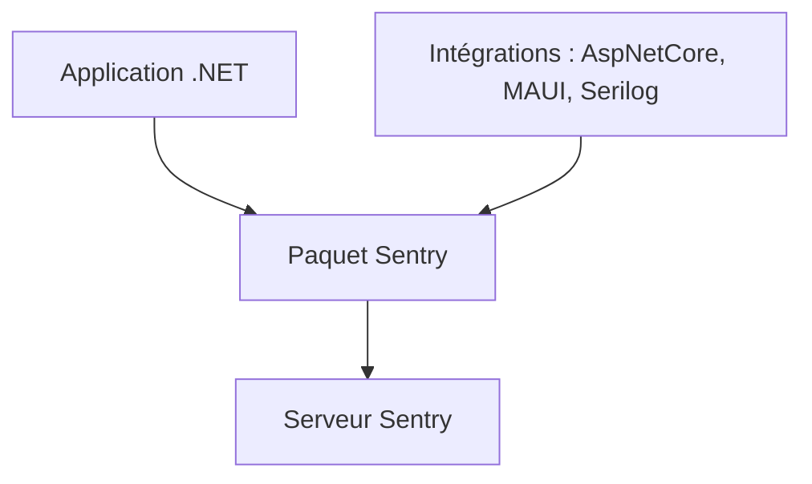

# getsentry/sentry-dotnet

> Kit de développement Sentry pour applications .NET, avec intégrations ASP.NET, MAUI, Serilog et d'autres.

## Le problème
Les erreurs d'une application .NET en production restent invisibles sans remontée centralisée.

## Ce que ça fait vraiment
Le dépôt publie une suite de paquets NuGet : le noyau `Sentry` et des intégrations (ASP.NET Core, Blazor, MAUI, Entity Framework, Hangfire, Quartz, journalisation, OpenTelemetry, profilage). Un paquet `Sentry.Extensions.AI` existe pour le suivi des modules d'agents IA. Le détail se trouve dans la documentation officielle.

## Comment c'est branché
Schéma simplifié d'après la fiche, sans diagramme fourni.

## Essayer
Aucune commande documentée dans le README : l'installation passe par les paquets NuGet listés dans le tableau.

## Coût et pièges
Il faut un serveur Sentry pour recevoir les événements ; ses tarifs ne sont pas décrits dans le README. Choisir entre Quartz3 (Quartz.NET 3.6+) et Quartz (4.x).

## Ce que ce n'est pas
Ce n'est pas l'outil de surveillance lui-même, seulement le client .NET. Unity et PowerShell ont des dépôts séparés.

## Alternatives
Aucune alternative citée dans le README.

## Pour toi
À ignorer pour un profil data / IA / MLOps sauf si tu écris en .NET : c'est un SDK mature mais sans lien avec le Python ou les pipelines de données.

