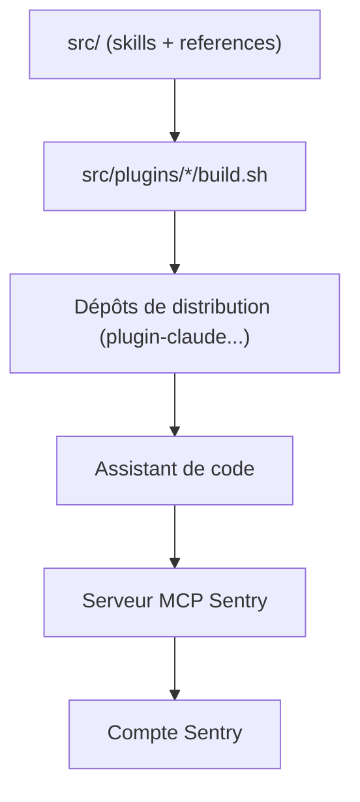

# getsentry/sentry-for-ai

> Skills and plugin that teach a coding assistant how to install and use Sentry.

## The problem
A coding assistant does not always know the Sentry installation steps per platform, nor how to triage production errors.

## What it actually does
- Source repository of skills, not an installable plugin: build scripts produce one per client (Claude Code, Copilot, Cursor, Codex, Grok, Antigravity).
- `sentry-instrument` adds Sentry (errors, traces, logs, profiling, replay) according to the detected platform.
- `sentry-debug-issue` finds an issue, optionally launches Seer, applies and resolves the fix.
- Other skills: alerts, OpenTelemetry export, Cocoa snapshots.

## How it is wired
Simplified diagram based on the sheet, no diagram provided.


## Trying it
```bash
git clone https://github.com/getsentry/sentry-for-ai.git
cd sentry-for-ai
src/plugins/agent-plugin/build.sh /tmp/sentry-agent-plugin
```
To use it, install your agent's plugin from its distribution repository, not this repository.

## Cost and gotchas
A Sentry account is essential; its pricing is not in the README. The MCP server is configured at installation; some skills require the authenticated `gh` CLI.

## What it is not
Not directly installable: the README says so. Not an observability tool in itself: it is a layer of instructions on top of Sentry.

## Alternatives
No alternative cited in the README.

## For you
Worth watching if Sentry already monitors your AI services; without Sentry, no interest, since the whole repository only makes sense with this SaaS.
