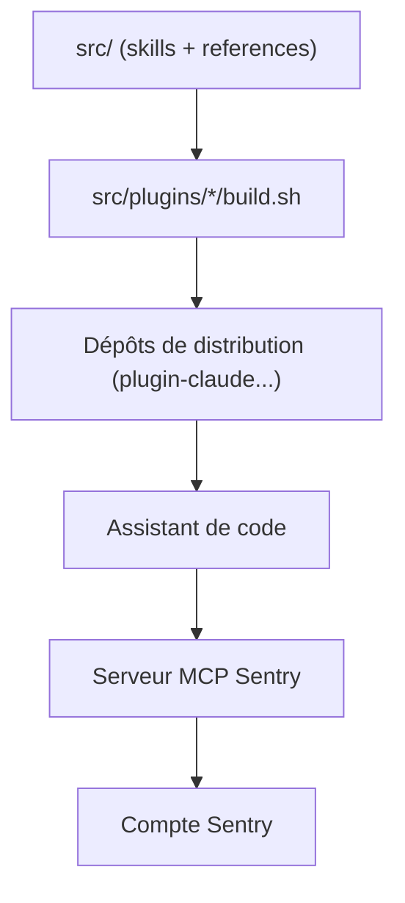

# getsentry/sentry-for-ai

> Skills et plugin qui apprennent à un assistant de code à installer et utiliser Sentry.

## Le problème
Un assistant de code ne connaît pas toujours les étapes d'installation de Sentry par plateforme, ni comment trier les erreurs de production.

## Ce que ça fait vraiment
- Dépôt source de skills, pas un plugin installable : des scripts de build en produisent un par client (Claude Code, Copilot, Cursor, Codex, Grok, Antigravity).
- `sentry-instrument` ajoute Sentry (erreurs, traces, logs, profilage, replay) selon la plateforme détectée.
- `sentry-debug-issue` retrouve une issue, lance éventuellement Seer, applique et résout le correctif.
- Autres skills : alertes, export OpenTelemetry, snapshots Cocoa.

## Comment c'est branché
Schéma simplifié d'après la fiche, sans diagramme fourni.


## Essayer
```bash
git clone https://github.com/getsentry/sentry-for-ai.git
cd sentry-for-ai
src/plugins/agent-plugin/build.sh /tmp/sentry-agent-plugin
```
Pour l'utiliser, installer le plugin de ton agent depuis son dépôt de distribution, pas ce dépôt.

## Coût et pièges
Un compte Sentry est indispensable ; son tarif n'est pas dans le README. Le serveur MCP est configuré à l'installation ; certains skills demandent la CLI `gh` authentifiée.

## Ce que ce n'est pas
Pas installable directement : le README le dit. Pas un outil d'observabilité en soi : c'est une couche d'instructions au-dessus de Sentry.

## Alternatives
Aucune alternative citée dans le README.

## Pour toi
À surveiller si Sentry sert déjà à superviser tes services d'IA ; sans Sentry, aucun intérêt, car tout le dépôt n'a de sens qu'avec ce SaaS.

