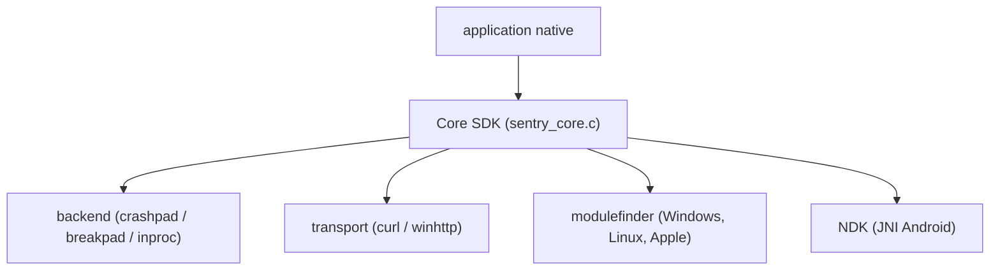

# getsentry/sentry-native

> Official Sentry SDK for C and C++: error and crash reporting for native applications.

## The problem
Crashes in native applications are hard to collect, symbolicate and aggregate on client machines.

## What it actually does
A CMake library that captures crashes through a backend of your choice (crashpad, breakpad, inproc, native or none) and sends events through a transport (curl, winhttp, none). It adds tags, breadcrumbs and context, release health sessions, Qt and WER integration. It also serves as the native foundation for the Android NDK, Flutter, Godot, .NET, Unity and Unreal SDKs.

## How it is wired


## Trying it
```bash
cmake -B build -DCMAKE_BUILD_TYPE=RelWithDebInfo
cmake --build build --parallel
cmake --install build --prefix install --config RelWithDebInfo
```

## Cost and gotchas
The SDK is free, but it sends reports to a Sentry server (DSN): a third-party service or an instance you host, pricing not documented here. Requires CMake; a C++17 compiler for crashpad and breakpad; known limitations on macOS and Windows.

## What it is not
It is not a tool for Python or the web, and it does not work without a Sentry server to send events to.

## Alternatives
No alternative named in the README.

## For you
Keep an eye on it: relevant only if you ship native code (C or C++) that you need to monitor in production; otherwise use the SDK for your language.
