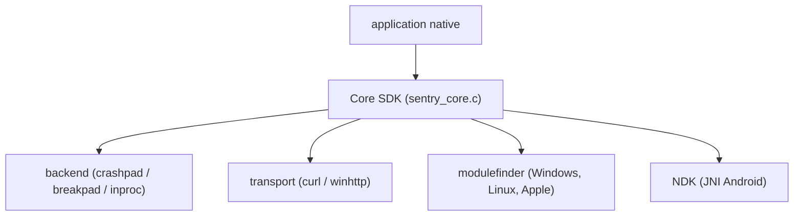

# getsentry/sentry-native

> SDK officiel de Sentry pour C et C++ : rapports d'erreurs et de plantages d'applications natives.

## Le problème
Les plantages d'applications natives sont difficiles à collecter, symboliser et agréger sur des machines clientes.

## Ce que ça fait vraiment
Bibliothèque CMake qui capture les plantages via un backend au choix (crashpad, breakpad, inproc, native ou aucun) et envoie les événements par un transport (curl, winhttp, aucun). Ajoute étiquettes, breadcrumbs et contexte, sessions de santé de release, intégration Qt et WER. Sert aussi de base native aux SDK Android NDK, Flutter, Godot, .NET, Unity, Unreal.

## Comment c'est branché


## Essayer
```bash
cmake -B build -DCMAKE_BUILD_TYPE=RelWithDebInfo
cmake --build build --parallel
cmake --install build --prefix install --config RelWithDebInfo
```

## Coût et pièges
SDK gratuit, mais il envoie les rapports à un serveur Sentry (DSN) : service tiers ou instance à héberger, tarification non documentée ici. Besoin de CMake ; compilateur C++17 pour crashpad et breakpad ; limites connues sur macOS et Windows.

## Ce que ce n'est pas
Ce n'est pas un outil pour Python ou le web, et il ne fonctionne pas sans un serveur Sentry à qui envoyer les événements.

## Alternatives
Aucune alternative nommée dans le README.

## Pour toi
À surveiller : pertinent seulement si tu livres du code natif (C ou C++) à surveiller en production ; sinon prends le SDK de ton langage.

