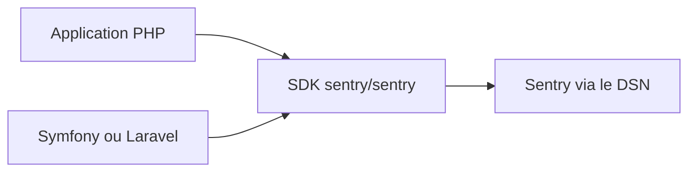

# getsentry/sentry-php

> The official Sentry SDK for PHP, which reports an application's errors and exceptions.

## The problem
Errors in a production PHP application go unnoticed without centralized reporting with their context.

## What it actually does
The SDK is initialized with a DSN, captures exceptions and errors, and sends them to Sentry with the detail needed to reproduce them. Official integrations exist for Symfony and Laravel; others are maintained by the community (Drupal, WordPress, TYPO3 and several more).

## How it is wired
Simplified diagram based on the card, no diagram provided.



## Trying it
```bash
composer require sentry/sentry
```

```php
\Sentry\init(['dsn' => '___PUBLIC_DSN___' ]);
\Sentry\captureException($exception);
```

## Cost and gotchas
The SDK is under the MIT license. You need a DSN provided by a Sentry server; the README says nothing about that service's pricing.

## What it is not
Not a complete monitoring tool: it is only the PHP client. Storage, alerts and the interface are elsewhere.

## Alternatives
No alternative named in the README.

## For you
Ignore: it is a PHP SDK, outside your data and AI stack, unless you monitor a PHP application.
