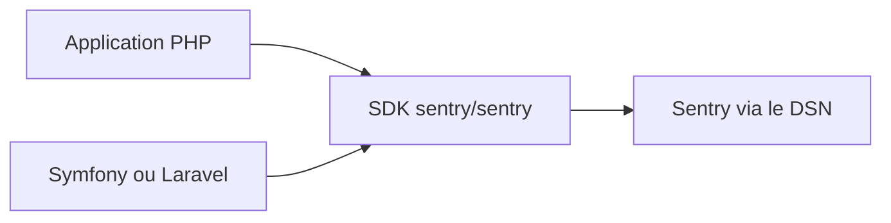

# getsentry/sentry-php

> Le SDK officiel de Sentry pour PHP, qui remonte erreurs et exceptions d'une application.

## Le problème
Les erreurs d'une application PHP en production passent inaperçues sans remontée centralisée avec leur contexte.

## Ce que ça fait vraiment
Le SDK s'initialise avec un DSN, capture exceptions et erreurs, et les envoie à Sentry avec le détail nécessaire pour les reproduire. Des intégrations officielles existent pour Symfony et Laravel, d'autres sont maintenues par la communauté (Drupal, WordPress, TYPO3 et plusieurs autres).

## Comment c'est branché
Schéma simplifié d'après la fiche, sans diagramme fourni.



## Essayer
```bash
composer require sentry/sentry
```

```php
\Sentry\init(['dsn' => '___PUBLIC_DSN___' ]);
\Sentry\captureException($exception);
```

## Coût et pièges
Le SDK est sous licence MIT. Il faut un DSN fourni par un serveur Sentry ; le README ne dit rien de la tarification de ce service.

## Ce que ce n'est pas
Pas un outil de supervision complet : c'est seulement le client PHP. Le stockage, les alertes et l'interface sont ailleurs.

## Alternatives
Aucune alternative nommée dans le README.

## Pour toi
À ignorer : c'est un SDK PHP, hors de ta pile data et IA, sauf si tu supervises une application PHP.

