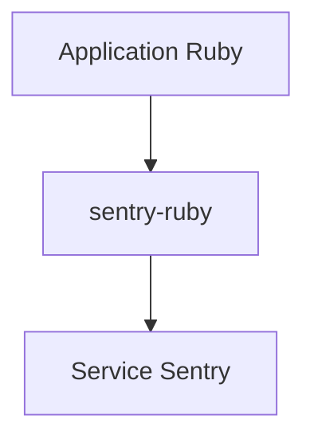

# getsentry/sentry-ruby

> Sentry's Ruby kit for reporting an application's errors, whose README was not provided.

## The problem
The README does not say: only the title "sentry-ruby/README.md" was provided.

## What it actually does
Not documented in the material provided. Only the repository name, the getsentry organization and the catalog's MIT license are known; no feature is claimed here.

## How it is wired
Simplified diagram based on the sheet, no diagram provided.

## Trying it
No command documented in the material provided.

## Cost and gotchas
Not documented. The name suggests an external Sentry service, without the README provided confirming it.

## What it is not
It is not a reliable sheet: the material is insufficient to describe the repository.

## Alternatives
No alternative named in the README.

## For you
Ignore for now: without content, no serious opinion is possible; re-read the repository before deciding.
