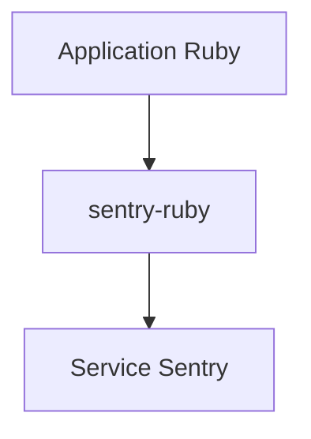

# getsentry/sentry-ruby

> Kit Ruby de Sentry pour remonter les erreurs d'une application, dont le README n'a pas été fourni.

## Le problème
Le README ne le dit pas : seul le titre « sentry-ruby/README.md » a été fourni.

## Ce que ça fait vraiment
Non documenté dans la matière fournie. Seuls le nom du dépôt, l'organisation getsentry et la licence MIT du catalogue sont connus ; aucune fonction n'est affirmée ici.

## Comment c'est branché
Schéma simplifié d'après la fiche, sans diagramme fourni.

## Essayer
Aucune commande documentée dans la matière fournie.

## Coût et pièges
Non documenté. Le nom laisse penser à un service Sentry externe, sans que le README fourni le confirme.

## Ce que ce n'est pas
Ce n'est pas une fiche fiable : la matière est insuffisante pour décrire le dépôt.

## Alternatives
Aucune alternative nommée dans le README.

## Pour toi
À ignorer pour l'instant : faute de contenu, aucun avis sérieux n'est possible ; relis le dépôt avant de décider.

