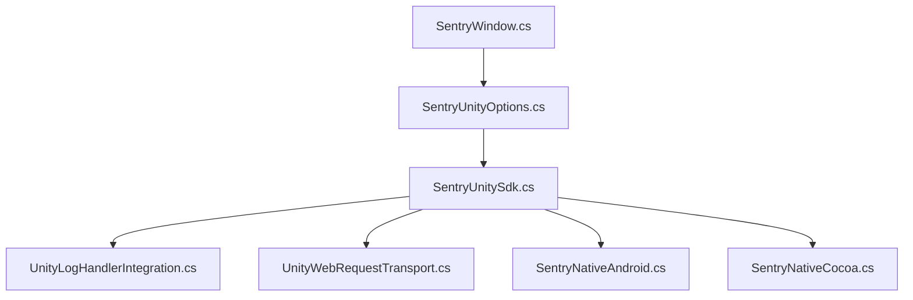

# getsentry/sentry-unity

> Sentry SDK for Unity: reports errors and native crashes from games to Sentry.

## The problem
Crashes in a Unity game, including on Android, iOS and native side, are hard to collect.

## What it actually does
`SentryUnitySdk` initializes from options set in an editor window, captures Unity logs and sends events through a `UnityWebRequest` transport. Android, iOS and native modules capture crashes; a post-processing step prepares the Xcode project.

## How it is wired


## Trying it
```
https://github.com/getsentry/unity.git
```
To be added through Unity's Package Manager; `#4.12.0` pins a version.

## Cost and gotchas
A Sentry project (account, DSN) is required; it is a hosted service with paid plans (not detailed in the README). Pinning a version blocks suggested updates.

## What it is not
Not a standalone game profiling tool: it sends the data to Sentry.

## Alternatives
No alternative named in the README.

## For you
Ignore: Unity game SDK, unrelated to data/AI/MLOps.
