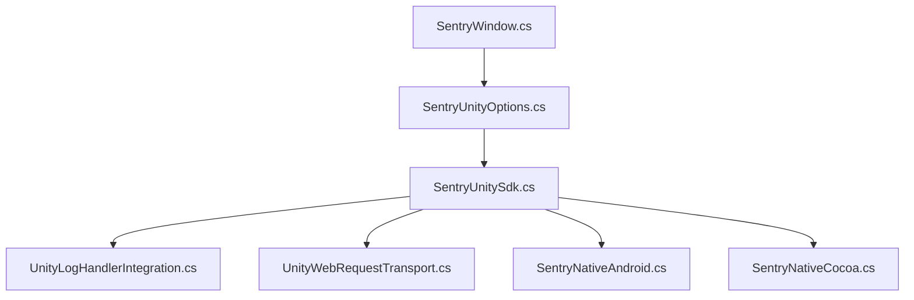

# getsentry/sentry-unity

> SDK Sentry pour Unity : remonte erreurs et plantages natifs des jeux vers Sentry.

## Le problème
Les crashs d'un jeu Unity, y compris côté Android, iOS et natif, sont difficiles à collecter.

## Ce que ça fait vraiment
`SentryUnitySdk` s'initialise depuis les options réglées dans une fenêtre d'éditeur, capture les logs Unity et envoie les événements par un transport `UnityWebRequest`. Des modules Android, iOS et natifs capturent les plantages ; un post-traitement prépare le projet Xcode.

## Comment c'est branché


## Essayer
```
https://github.com/getsentry/unity.git
```
À ajouter via le Package Manager d'Unity ; `#4.12.0` fixe une version.

## Coût et pièges
Il faut un projet Sentry (compte, DSN), service hébergé aux offres payantes (non détaillées dans le README). La fixation de version bloque les mises à jour suggérées.

## Ce que ce n'est pas
Pas un outil de profilage de jeu autonome : il envoie les données à Sentry.

## Alternatives
Aucune alternative nommée dans le README.

## Pour toi
Ignorer : SDK de jeu Unity, sans lien avec data/IA/MLOps.

