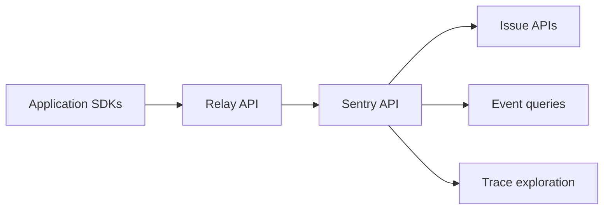

# getsentry/sentry

> Debugging platform that captures errors, traces and replays sent by application SDKs.

## The problem
Detect, trace and fix errors in a production application.

## What it actually does
The README is almost empty: a tagline, a list of official SDKs (JavaScript, Python, Go, Rust, Java, Swift, Unity…) and links. The partial code graph shows APIs for issues, events, traces, logs, profiling, replays and a "Seer" AI-assist indexing. Self-hosted deployment is not described here.

## How it is wired

## Trying it
No command documented in the README.

## Cost and gotchas
Not documented in this README. No reliable information on the free tier or self-hosting.

## What it is not
Not an infrastructure monitoring tool: it focuses on application errors. This sheet is minimal, for lack of material.

## Alternatives
No alternative named in the README.

## For you
Keep an eye on it: a well-known reference for error tracking, but the license is unidentified and the README does not allow a firmer conclusion.
