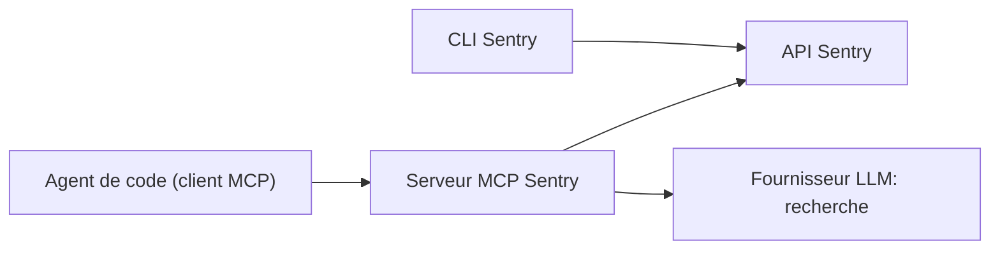

# getsentry/toolkit

> Sentry CLI and MCP server so that coding agents can consult Sentry errors, traces and issues.

## The problem
Coding agents cannot see production errors; copying traces into the prompt by hand is slow.

## What it actually does
The repository contains the Sentry CLI, a remote MCP server (Cloudflare) or a local one over stdio (`@sentry/mcp-server`), and a Claude Code plugin with a subagent. The natural-language search tools use an LLM (OpenAI, Azure, Anthropic or OpenRouter). It supports self-hosting via `SENTRY_HOST`.

## How it is wired
Simplified diagram based on the sheet, no diagram provided.



## Trying it
```shell
claude plugin marketplace add getsentry/sentry-mcp
claude plugin install sentry-mcp@sentry-mcp
npx @sentry/mcp-server@latest auth login
npx @sentry/mcp-server@latest
```

## Cost and gotchas
A Sentry account and token are required; the search tools need an LLM key at your expense. Sentry API rate limits apply: avoid parallel calls.

## What it is not
Not a general-purpose MCP for all of Sentry: it targets debugging during development. A license is present but not identified by GitHub.

## Alternatives
No alternative cited in the README.

## For you
Adopt if you use Sentry with a coding agent: official publisher, recent activity, but check the license.
