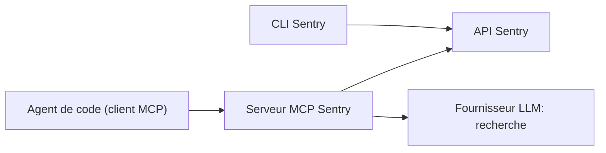

# getsentry/toolkit

> CLI Sentry et serveur MCP pour que les agents de code consultent erreurs, traces et issues Sentry.

## Le problème
Les agents de code ne voient pas les erreurs de production ; copier des traces à la main dans le prompt est lent.

## Ce que ça fait vraiment
Le dépôt contient la CLI Sentry, un serveur MCP distant (Cloudflare) ou local en stdio (`@sentry/mcp-server`), et un plugin Claude Code avec un sous-agent. Les outils de recherche en langage naturel utilisent un LLM (OpenAI, Azure, Anthropic ou OpenRouter). Il gère l'auto-hébergement via `SENTRY_HOST`.

## Comment c'est branché
Schéma simplifié d'après la fiche, sans diagramme fourni.



## Essayer
```shell
claude plugin marketplace add getsentry/sentry-mcp
claude plugin install sentry-mcp@sentry-mcp
npx @sentry/mcp-server@latest auth login
npx @sentry/mcp-server@latest
```

## Coût et pièges
Compte Sentry et jeton requis ; les outils de recherche demandent une clé LLM à ta charge. Les limites de débit de l'API Sentry s'appliquent : éviter les appels parallèles.

## Ce que ce n'est pas
Pas un MCP généraliste de tout Sentry : il vise le débogage en développement. Licence présente mais non identifiée par GitHub.

## Alternatives
Aucune alternative citée dans le README.

## Pour toi
Adopter si tu utilises Sentry avec un agent de code : éditeur officiel, activité récente, mais vérifie la licence.

