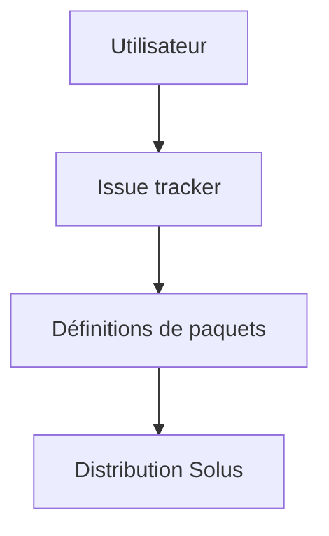

# getsolus/packages

> Package definitions of the Solus Linux distribution and the associated bug tracker.

## The problem
A distribution needs a central place for its package recipes and requests.

## What it actually does
Contains Solus package definitions and the ticket tracker: bugs, packaging problems, requests to add, update or remove packages, security flaws. The README points to the packaging documentation and the help center. Donations go through Open Collective.

## How it is wired
Simplified diagram based on the sheet, no diagram provided.



## Trying it
```bash
# Aucune commande documentée : ouvrir un ticket depuis les modèles du dépôt
```

## Cost and gotchas
Free. 330 open issues. License not identified by GitHub.

## What it is not
Not an installable tool: these are the sources of a Linux distribution.

## Alternatives
None cited in the README.

## For you
Ignore: only concerns Solus maintainers and users, unrelated to a data / AI / MLOps profile.
