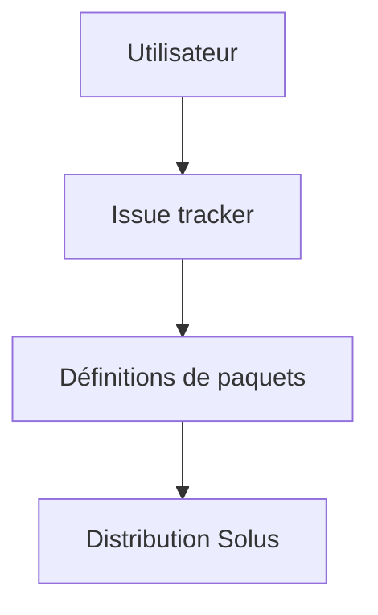

# getsolus/packages

> Définitions des paquets de la distribution Linux Solus et suivi des bugs associé.

## Le problème
Une distribution a besoin d'un endroit central pour ses recettes de paquets et ses demandes.

## Ce que ça fait vraiment
Contient les définitions de paquets de Solus et le suivi des tickets : bugs, problèmes de packaging, demandes d'ajout, de mise à jour ou de retrait, failles de sécurité. Le README renvoie à la documentation de packaging et au centre d'aide. Les dons passent par Open Collective.

## Comment c'est branché
Schéma simplifié d'après la fiche, sans diagramme fourni.



## Essayer
```bash
# Aucune commande documentée : ouvrir un ticket depuis les modèles du dépôt
```

## Coût et pièges
Gratuit. 330 issues ouvertes. Licence non identifiée par GitHub.

## Ce que ce n'est pas
Pas un outil installable : ce sont les sources d'une distribution Linux.

## Alternatives
Aucune citée dans le README.

## Pour toi
Ignorer : concerne uniquement les mainteneurs et utilisateurs de Solus, sans lien avec un profil data / IA / MLOps.

