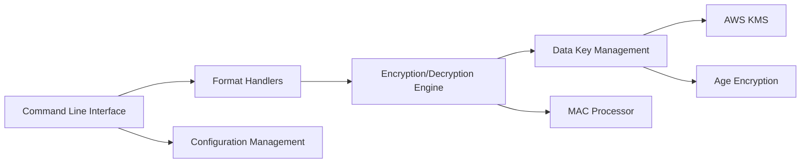

# getsops/sops

> Editor for encrypted files (YAML, JSON, ENV, INI) to version secrets without exposing them.

## The problem
Configuration secrets end up in plain text in Git or in a separate vault that drifts from the code. Encrypting by hand with PGP is tedious and unreadable in review.

## What it actually does
Encrypts the values of a structured file while keeping the keys readable, so diffs remain usable.
A data key (AES256-GCM) encrypts the values; it is itself encrypted by one or more master keys: AWS KMS, GCP KMS, Azure Key Vault, HuaweiCloud KMS, age, PGP.
A MAC protects integrity; `.sops.yaml` sets rules per path.
Project born at Mozilla, donated to the CNCF in 2023.

## How it is wired

## Trying it
No command documented in the README: it points to getsops.io.

## Cost and gotchas
Free; a cloud KMS key is billed by the provider, age or PGP stay local. Losing the master key means losing the secrets.

## What it is not
Not an online secrets manager with rotation or audit. MPL-2.0: weak copyleft, at file level. The README is very terse.

## Alternatives
The README cites its inspirations (hiera-eyaml, credstash, sneaker, password store) without comparing them.

## For you
Adopt it for your pipeline and deployment configs: with age, it is a simple, audited way to keep API keys and credentials in the repository.
