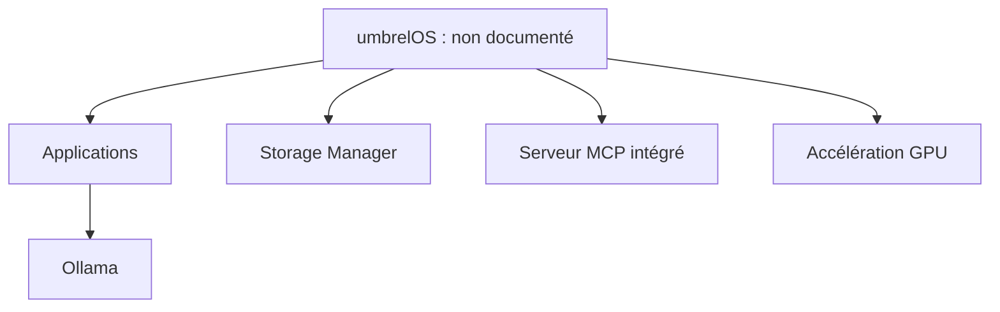

# getumbrel/umbrel

> Home server operating system for self-hosting your applications and data.

## The problem
Owning your data and applications without depending on the cloud takes a lot of manual configuration.

## What it actually does
umbrelOS installs directly on a machine (Intel/AMD, Raspberry Pi 5, virtual machine) and provides applications, multiple accounts, storage management with RAID, a built-in MCP server for agents, GPU acceleration (Ollama, Jellyfin) and import from Google Drive or Dropbox. The README does not describe the internal architecture.

## How it is wired


## Trying it
```bash
# Aucune commande documentée : télécharger l'image sur umbrel.com/downloads.
```

## Cost and gotchas
Free on your own hardware. It installs on its own on the machine, not on top of an existing Linux distribution.

## What it is not
Not an application you add to Linux. Not an MLOps tool, despite the GPU support. License not identified.

## Alternatives
No alternative cited in the README.

## For you
Ignore: rather a personal server project, with no direct value for your data / AI work.
