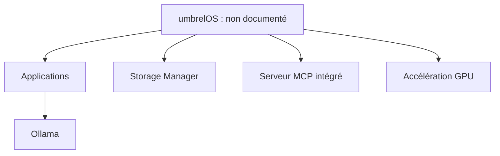

# getumbrel/umbrel

> Système d'exploitation de serveur domestique pour auto-héberger ses applications et ses données.

## Le problème
Posséder ses données et ses applications sans dépendre du cloud demande beaucoup de configuration manuelle.

## Ce que ça fait vraiment
umbrelOS s'installe directement sur une machine (Intel/AMD, Raspberry Pi 5, machine virtuelle) et fournit applications, comptes multiples, gestion du stockage avec RAID, serveur MCP intégré pour agents, accélération GPU (Ollama, Jellyfin) et import depuis Google Drive ou Dropbox. Le README ne décrit pas l'architecture interne.

## Comment c'est branché


## Essayer
```bash
# Aucune commande documentée : télécharger l'image sur umbrel.com/downloads.
```

## Coût et pièges
Gratuit sur son propre matériel. Il s'installe seul sur la machine, pas par-dessus une distribution Linux existante.

## Ce que ce n'est pas
Pas une application que l'on ajoute à Linux. Pas un outil de MLOps, malgré le support GPU. Licence non identifiée.

## Alternatives
Aucune alternative citée dans le README.

## Pour toi
À ignorer : plutôt un projet de serveur personnel, sans valeur directe pour ton travail data / IA.

