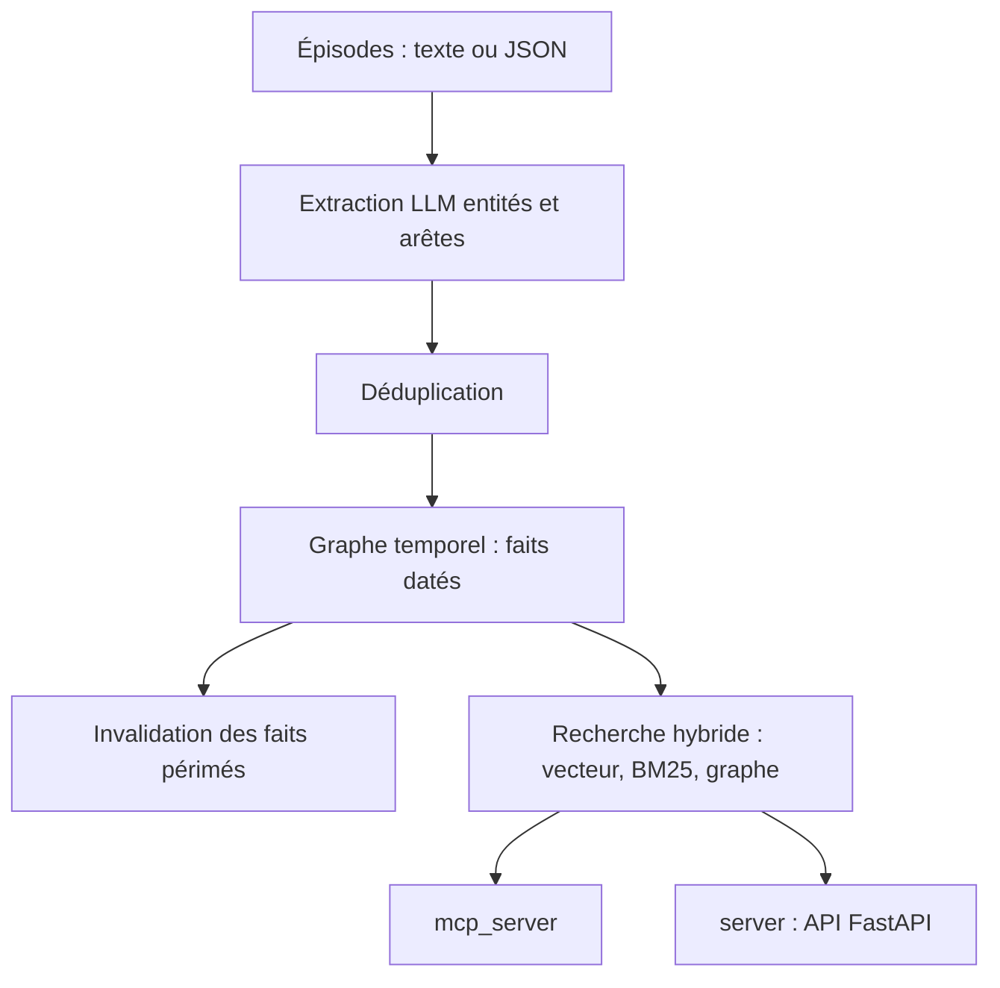

# getzep/graphiti

> Temporal context-graph framework for agents: facts have a validity window.

## The problem
A classic RAG processes data in batches and summarizes it statically: it breaks down as soon as the data changes often.
When a fact becomes false, nothing tells you what was true before, or where the fact came from.

## What it actually does
Builds a graph of entities, relationships and facts where each fact carries a validity window: when it became true, when it was superseded. Old facts are invalidated, not deleted.
Everything traces back to "episodes", the raw ingested data, which gives full traceability from the derived fact down to the source.
Ontology either prescribed (entity and edge types defined as Pydantic models) or learned, letting it emerge from the data; incremental construction with no batch recomputation.
Hybrid retrieval combining semantic embeddings, BM25 keywords and graph traversal; Neo4j, FalkorDB and Amazon Neptune backends (Kuzu deprecated); MCP server and FastAPI REST service provided.

## How it is wired


## Trying it
```bash
pip install graphiti-core
uv add graphiti-core[falkordb]
docker run -p 6379:6379 -p 3000:3000 -it --rm falkordb/falkordb:latest
docker compose --profile falkordb up
```

## Cost and gotchas
OpenAI key by default for inference and embeddings; every ingested episode costs LLM calls.
`SEMAPHORE_LIMIT` is deliberately low (10) to avoid 429 errors: the slowness you observe comes from there, adjust it to your quota.

## What it is not
It is not a managed platform: Zep, from the same vendor, is; Graphiti is self-hosted, with no user management, threads or dashboard.
It is not compatible with just any model: the README warns that models without reliable structured output cause ingestion failures, especially small ones.
Anonymous telemetry is enabled by default (PostHog), and can be disabled with `GRAPHITI_TELEMETRY_ENABLED=false`.

## Alternatives
- GraphRAG — compared in detail: batch processing, static summarization, no custom entity types.
- Zep — the managed offering from the same vendor, with a proprietary graph database and an SLA.

## For you
The right choice if you are building agent memory that must know what was true yesterday; plan for a graph database to operate.
