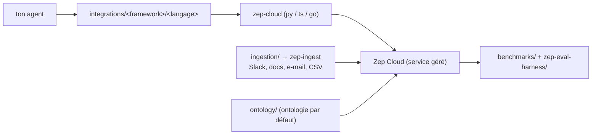

# getzep/zep

> Repo of examples, framework integrations and tools around Zep Cloud agent memory.

## The problem
Plugging agent memory into LangGraph, CrewAI or the Vercel SDK requires glue code every time, and the official examples are scattered across languages.

## What it actually does
This repo **is not** the product: it contains example code, integration packages and tools for building agent memory with Zep Cloud. `examples/` groups apps and snippets in Python, TypeScript and Go. `integrations/` contains packages organized by framework then by language, built, tested and published independently: Google ADK, Microsoft Agent Framework, AutoGen, AG2, CrewAI, LangGraph, LiveKit, Pydantic AI, Strands Agents in Python; Google ADK, Mastra, Vercel AI SDK in TypeScript; Google ADK in Go. `ingestion/` ships `zep-ingest`, a bulk ingestion pipeline (Slack, documents, email, JSON/CSV, fact triples). `benchmarks/` covers LoCoMo and LongMemEval, and `zep-eval-harness/` covers ingestion and retrieval evaluation.

## How it is wired


## Trying it
```bash
pip install zep-cloud
npm install @getzep/zep-cloud
go get github.com/getzep/zep-go/v3
```

## Cost and gotchas
Zep Cloud is a managed service: sign-up at `getzep.com` and a key are required, and pricing is not documented here. `legacy/` contains Zep Community Edition, marked deprecated and **unsupported**: it is not a self-hosting path.

## What it is not
Not the memory engine: the temporal knowledge graph that powers Zep is the separate project Graphiti. Not a repo to install in one go: each integration package is published separately, and the README points to `integrations/README.md` for the actual release status.

## Alternatives
- Graphiti: the free temporal knowledge graph framework, without the managed service.

## For you
The real repo to read is Graphiti; this one is for quickly copying a LangGraph integration.
